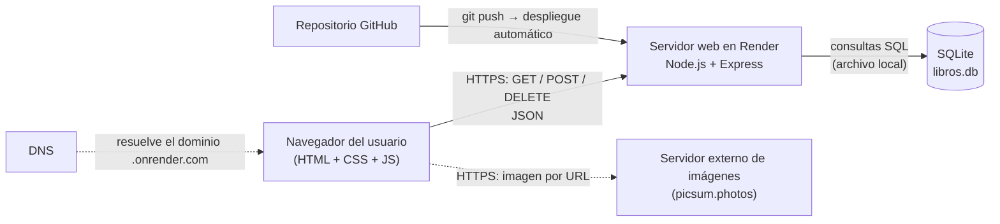

# Topología del sistema

Arquitectura **cliente-servidor en tres capas** (presentación, lógica, datos).
Los nodos y sus enlaces:

| Capa | Nodo | Tecnología | Responsabilidad |
| --- | --- | --- | --- |
| Presentación | Navegador (cliente) | HTML, CSS, JavaScript | Mostrar datos y capturar acciones del usuario |
| Lógica | Servidor web | Node.js + Express | Validar, aplicar reglas, responder peticiones HTTP |
| Datos | Base de datos | SQLite (archivo) | Guardar los libros de forma persistente |

Principios aplicados:

- **Separación de responsabilidades**: cada capa hace una sola cosa; el navegador nunca accede directo a la base.
- **Comunicación por protocolo estándar**: cliente y servidor solo se hablan por HTTP(S) con JSON.
- **Topología en estrella desde el servidor**: muchos clientes se conectan a un único servidor central.
- **Recursos externos desacoplados**: las imágenes por URL las descarga el navegador directamente del servidor externo.
